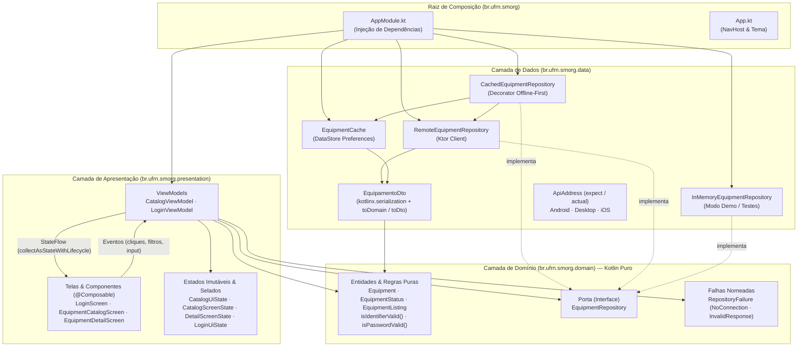
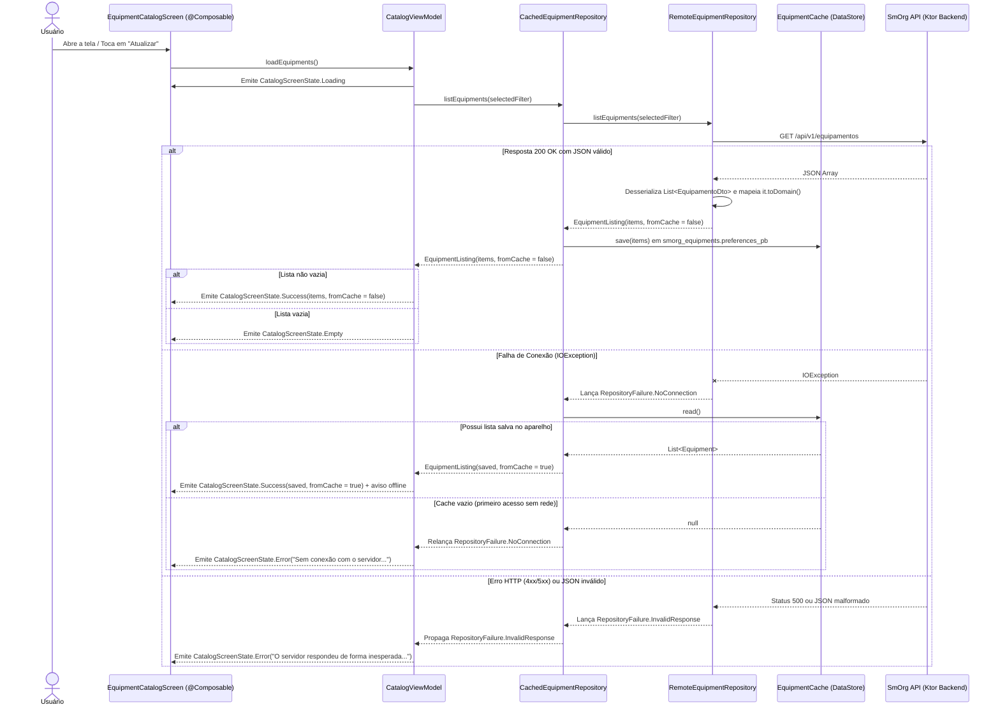

# Arquitetura do Sistema — SmOrg Mobile

**Disciplina:** DIM0524 — Desenvolvimento de Sistemas para Dispositivos Móveis (2026.2)  
**Docente:** Fernando Figueira Filho — UFRN / DIMAp  
**Estudante:** Miguel Xavier de Morais (`20240027427`)

---

## 1. Visão Geral e Diagrama de Camadas

O aplicativo **SmOrg Mobile** foi estruturado em **Kotlin Multiplatform (KMP)** com **Compose Multiplatform**, concentrando toda a lógica de domínio, acesso a dados, gerenciamento de estado e interface gráfica no conjunto de fontes compartilhado (`commonMain`).

O código está organizado em três camadas bem delimitadas dentro do pacote `br.ufrn.smorg`, respeitando a **Regra da Dependência** (todas as dependências apontam para o domínio):

### Responsabilidades de Cada Camada

| Camada | Pacote | Pode depender de | Não pode depender de |
| :--- | :--- | :--- | :--- |
| **Domínio** | `br.ufrn.smorg.domain` | Apenas biblioteca padrão do Kotlin (`kotlin.*`) | Compose, Ktor Client, DataStore, ViewModel ou frameworks externos |
| **Dados** | `br.ufrn.smorg.data` | `domain`, Ktor Client, `kotlinx.serialization`, DataStore | `presentation` e componentes de interface Compose |
| **Apresentação** | `br.ufrn.smorg.presentation` | `domain`, Compose Multiplatform, `androidx.lifecycle.ViewModel`, Coroutines/Flow | Implementações concretas de `data` (`EquipamentoDto`, Ktor, DataStore) |
| **Raiz de Composição** | `br.ufrn.smorg` | Todas as camadas (apenas para instanciar e conectar as dependências em `AppModule.kt`) | — |

---

## 2. O Caminho de um Dado: Do Backend até a Tela

O diagrama de sequência abaixo ilustra o fluxo completo de ponta a ponta quando o usuário abre a tela de catálogo ou seleciona um filtro de status:

1. **Desacoplamento DTO $\leftrightarrow$ Domínio:** O JSON da API é recebido em `EquipamentoDto` (`@Serializable`), configurado com `ignoreUnknownKeys = true` para que novos campos no backend não quebrem o cliente móvel. Em seguida, `toDomain()` converte o DTO para a entidade imutável `Equipment`.
2. **Tradução de Exceções de Infraestrutura:** `RemoteEquipmentRepository` configura `expectSuccess = true` no Ktor Client e captura `IOException`, `ResponseException`, `ContentConvertException` e `SerializationException`, traduzindo-as nas exceções semânticas do domínio `RepositoryFailure.NoConnection` e `RepositoryFailure.InvalidResponse`. Assim, o `CatalogViewModel` não conhece nenhuma classe do Ktor.

---

## 3. Justificativa do Gerenciamento de Estado

### Escolha Adotada: `ViewModel` Multiplataforma + `StateFlow` + Interfaces Seladas (`sealed interface`)

* **Sobrevivência a mudanças de configuração e ciclo de vida:** Ao utilizar `androidx.lifecycle.ViewModel` em `commonMain` (`CatalogViewModel` e `LoginViewModel`), o estado sobrevive à rotação de tela no Android e permanece desacoplado do ciclo de recomposição das funções `@Composable`. As corrotinas são lançadas no `viewModelScope`, garantindo cancelamento automático (concorrência estruturada) quando o ViewModel é destruído.
* **Fluxo Unidirecional de Dados (UDF) com `StateFlow`:** Cada ViewModel mantém um `MutableStateFlow` **privado** (`_state`) e expõe apenas um `StateFlow` **público** somente leitura (`state`). A interface coleta o fluxo com `collectAsStateWithLifecycle()`, interrompendo a coleta quando a aplicação vai para segundo plano, e envia eventos apenas invocando métodos do ViewModel (`loadEquipments()`, `selectFilter()`, `onIdentifierChange()`, `submitLogin()`).
* **Exaustividade garantida pelo compilador com `sealed interface`:** Os estados de tela (`CatalogScreenState` e `DetailScreenState`) modelam explicitamente os quatro cenários exigidos: `Loading`, `Empty`, `Success` e `Error`. Na camada de UI, a renderização usa `when (screenState)` **sem ramo `else`**, garantindo em tempo de compilação que nenhum estado deixe de ser tratado visualmente.

### Alternativas Consideradas e Descartadas

* **Estado local na composição (`remember { mutableStateOf(...) }` + `LaunchedEffect`):** Utilizado inicialmente na Sprint 1, mas descartado na Sprint 2 porque mistura lógica de negócios e chamadas de rede com código de interface, perde dados em mudanças de configuração e dificulta testes unitários isolados sem renderizar a UI.
* **`LiveData` (AndroidX):** Descartado por ser específico da plataforma Android e não possuir integração nativa com operadores de Kotlin Coroutines (`Flow`) nem suporte multiplataforma em `commonMain` (Desktop/iOS) equivalente ao `StateFlow` + `Turbine`.

---

## 4. Justificativa da Persistência Local e Estratégia Offline-First

### Escolha Adotada: `DataStore Preferences` Multiplataforma + Padrão Decorator (`CachedEquipmentRepository`)

* **Adequação ao volume e formato dos dados:** O catálogo de equipamentos de um laboratório didático consiste em uma coleção enxuta de itens consultados frequentemente. Persistir a última listagem serializada em JSON no `androidx.datastore:datastore-preferences-core` em um arquivo por plataforma (`filesDir` no Android e `~/.smorg-mobile` no Desktop) garante leitura e escrita assíncronas, atômicas e livres de bloqueio da thread principal.
* **Transparência arquitetural via Padrão Decorator:** `CachedEquipmentRepository` implementa a mesma interface `EquipmentRepository` que `RemoteEquipmentRepository`. O `CatalogViewModel` não precisa saber como o cache funciona: ele apenas consome `EquipmentRepository` e verifica a flag `fromCache: Boolean` retornada em `EquipmentListing` para exibir o aviso visual de dados offline na tela.

### Alternativas Consideradas e Descartadas

* **`SharedPreferences` nativo:** Descartado por não ser multiplataforma (`commonMain`), por executar operações síncronas passíveis de bloquear a UI thread e por não oferecer segurança transacional com Coroutines.
* **Bancos relacionais locais (`Room KMP` / `SQLDelight`):** Embora excelentes para grandes volumes de dados relacionais com consultas SQL complexas, exigiriam geração de código por plataforma (KSP/drivers nativos SQLite) desproporcional para o armazenamento de snapshot do catálogo de equipamentos do MVP. O uso do padrão Repository no domínio, contudo, permite substituir `EquipmentCache` por SQLDelight/Room no futuro sem alterar uma única linha do `CatalogViewModel` ou das telas Compose.
